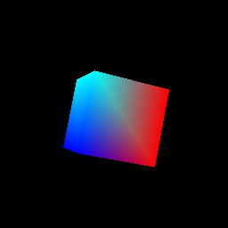

# GPUemu



### What is this project?

This started as a university project for the System Firmware (*Oprogramowanie Systemowe*) course, intended to emulate a simple PCI device in UEFI using QEMU. The scope eventually expanded to a full GPU emulation, covering everything from PCI communication to shader assembly code, VRAM management, and a graphics API. It is mainly used as a learning tool to understand how GPUs work from the ground up.

Currently, the project features a multithreaded software rasterizer inside QEMU, a custom matrix/scalar shader ISA with a two-pass assembler, a UEFI Option ROM driver with VRAM management, and a suite of UEFI benchmark and test applications.

This project could be extended in many ways, and the final product is not yet fully defined.

## Building

Since most of this project relies on modifying QEMU and EDK2 projects, we decided to avoid creating two different forks. Instead, we write our code as patches for both QEMU and EDK2 sources.

Here are the instructions:
-   Download needed packages:
    -   For Debian based distros:
    ``` sh
    apt install make g++ gcc python3 uuid-dev nasm python3-pip python3-venv ninja-build libglib2.0-dev cmake libpixman-1-dev libgtk-3-dev
    ```
    -   For Arch based distros:
    ```
    pacman -Syu make python3 gcc ninja meson glib2 glib2-devel base-devel pixman gtk3 nasm
    ```


-   Run `scripts/apply_patches.sh`
    -   This prepares submodules, applies patches to them, and symlinks directories to their respective submodules.

-   Run `scripts/build_all.sh`
    -   This builds both QEMU and EDK2. The default build type is `DEBUG`. You can use different build types by passing the name as a parameter (currently supports only `RELEASE`).

## Running

To start QEMU with the GPU emulation card and UEFI environment:
```bash
./scripts/run.sh [DEBUG|RELEASE] [CommandToRun]
```
- CommandToRun argument enters a command on start of the EFI shell.

### Applications & Demos

You can run applications interactively inside the shell, or pass them as arguments to `./scripts/run.sh`:

- **Showcase Demo (`SpirvApp`)**:
  Start demo of implemented features which both include 3D and compute workloads:
  ```bash
  ./scripts/run.sh SpirvApp
  ```

  

- **Test Harness (`TestHarness`)**:
  Runs automated verification tests for rasterization (blending, primitives, depth) and compute shaders (SSBOs, parallel dispatch):
  ```bash
  # Run all tests
  ./scripts/run.sh TestHarness

  # Run specific tests using wildcard filters
  ./scripts/run.sh TestHarness --test-case=raster.*
  ./scripts/run.sh TestHarness --test-case=compute.*

  # List all available tests
  ./scripts/run.sh TestHarness --test-list
  ```

- **Debugging**:
  To launch QEMU with GDB attached:
  ```bash
  ./scripts/debug.sh [DEBUG|RELEASE] [CommandToRun]
  ```

## Documentation

Architectural specifications and ISA definitions are documented in [`doc/`](doc/):
- [GPU Hardware Specification](doc/gpuSpec.md)
- [Shader ISA Reference](doc/shaderSpec.md)
- [Software Rasterizer Pipeline & Threading](doc/renderThreads.md)
- [Shader Compiler Specification](doc/compilerSpec.md)

APIs, the Driver, and the GPU are documented via comments within the code itself.
